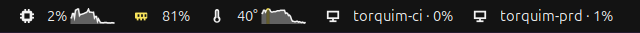
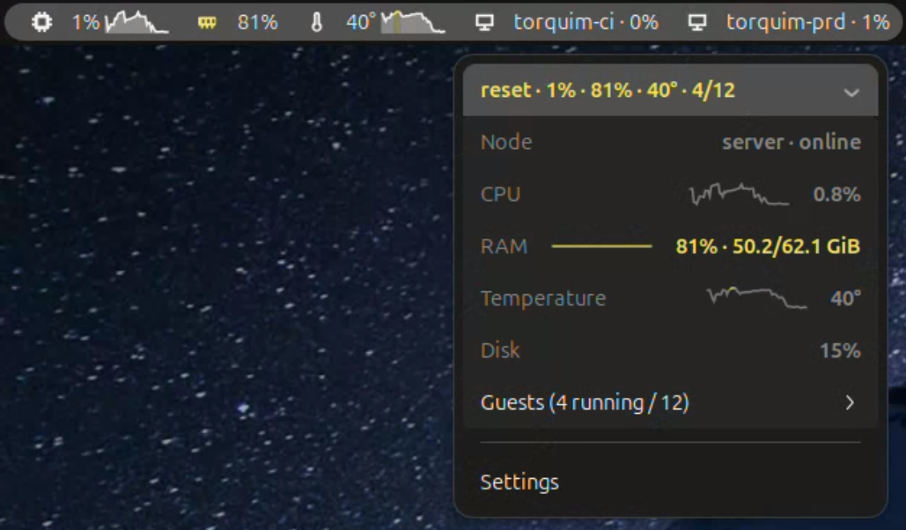
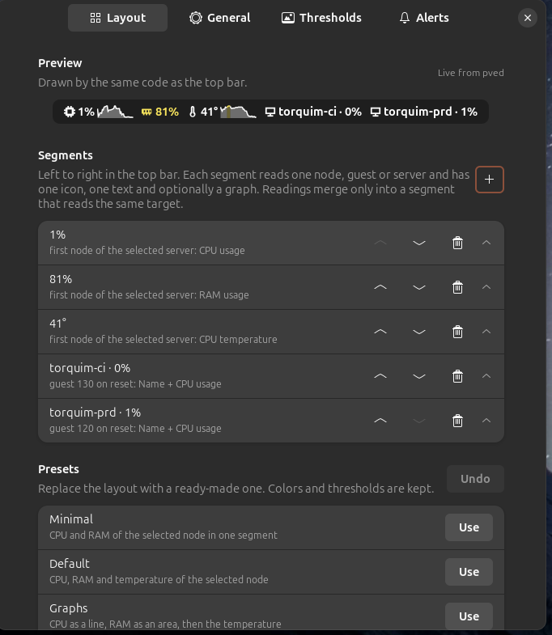

# pve-bar

Your Proxmox VE servers in the GNOME top bar, next to Wi-Fi:



- the **CPU**, **RAM** and **temperature** of a node, with small graphs of the last minutes, changing color as they heat up;
- any **VM or container** you pin, with its name and CPU;
- **several servers or clusters** at once; one being down never hides the others.

Click it for each server's nodes (CPU, RAM, temperature, disk), its guests and their details:



pve-bar only reads. It never starts, stops or changes anything in Proxmox, and its API token cannot.

## How it fits together

- **pved**: a small service in your session (`systemd --user`). Every 10 s it makes one `GET /cluster/resources` call per server, rounds the numbers to what the panel shows, and publishes only what changed on the session D-Bus. It keeps the last hour of every value for the graphs. It uses about 6 MB of RAM and under 0.02 % of one core ([measured](docs/FOOTPRINT.md)).
- **pvectl**: the command line (`pvectl setup`, `status`, `doctor`).
- **The GNOME extension**: draws what pved publishes. It never touches the network, files or timers itself. Without pved it shows `pve off`.
- **pve-temp-agent** (optional): a 500 KB program on the Proxmox host that serves its temperatures, since the Proxmox API has none.

Details are in [docs/ARCHITECTURE.md](docs/ARCHITECTURE.md).

## Requirements

- **Desktop:** GNOME Shell 46 to 50 (Ubuntu 24.04 or newer), X11 or Wayland, with the GNOME Keyring (standard).
- **Server:** Proxmox VE 7 or newer.
- **To build:** a Rust toolchain, 1.88 or newer ([rustup](https://rustup.rs)), and a C compiler.

## Setup

Each step says where to run it:

- 🖥️ **desktop**: the machine with GNOME, as your own user (never with `sudo`);
- 🗄️ **Proxmox host**: a root shell on the server (SSH, or **Node → Shell** in the web UI).

The examples use `pve.lan` for the Proxmox host and `home` as the name pve-bar gives it; use your own address and any short name.

### 1. Build and install

🖥️ **desktop**

```bash
sudo apt install build-essential libglib2.0-bin git    # once
curl --proto '=https' --tlsv1.2 -sSf https://sh.rustup.rs | sh   # once, if you have no Rust

git clone https://github.com/pauloeduardods/pve-bar.git
cd pve-bar
./install.sh
```

That builds pved and pvectl, installs them with the extension for your user, and enables the extension. Nothing needs root. Run `git pull && ./install.sh` again to upgrade.

GNOME Shell keeps the extension code it loaded, so it appears (or a new version shows up) after the shell reloads:

- **X11:** press **Alt+F2**, type `r`, Enter. Your windows stay open.
- **Wayland:** log out and back in.

The bar shows `pve off` or no servers until the next steps.

### 2. Create a read-only API token

🗄️ **Proxmox host**

```bash
pveum user add monitor@pve --comment "pve-bar (read-only)"
pveum user token add monitor@pve pve-bar --privsep 1     # prints the secret once: copy it
pveum acl modify / --users monitor@pve --tokens 'monitor@pve!pve-bar' --roles PVEAuditor
```

The role goes to **both** the user and the token: a token with privilege separation only gets what both have, so a role given to the token alone grants nothing. `PVEAuditor` can only read, and `monitor@pve` has no password, so nobody can log in with it.

The same in the web UI, under **Datacenter → Permissions**:

1. **Users → Add**: user `monitor`, realm `Proxmox VE authentication server` (`pve`).
2. **API Tokens → Add**: user `monitor@pve`, token id `pve-bar`, **Privilege Separation** checked. Copy the secret: Proxmox shows it only once.
3. **Add → User Permission**: path `/`, user `monitor@pve`, role **PVEAuditor**.
4. **Add → API Token Permission**: path `/`, token `monitor@pve!pve-bar`, role **PVEAuditor**.

While you are on the host, note its certificate fingerprint for the next step:

```bash
openssl x509 -in /etc/pve/local/pve-ssl.pem -noout -fingerprint -sha256
```

### 3. Add the server to pve-bar

🖥️ **desktop**

```bash
pvectl setup home
```

```
Adding server home.
Proxmox URL (https://host:8006): https://pve.lan:8006
API token id (user@realm!token) [monitor@pve!pve-bar]:

The server presents a certificate that is not from a public CA (Proxmox's
own self-signed one, usually). Its SHA-256 fingerprint is:

  AB:CD:EF:…:12

Compare it with Proxmox → your node → System → Certificates → pve-ssl.pem
(or on the host: openssl x509 -in /etc/pve/local/pve-ssl.pem -noout -fingerprint -sha256).
Do they match? (y/N): y
API token secret (the UUID shown once when the token was created):
Token works: 1 node(s), 12 guest(s).

Optional: pve-temp-agent on this host shows its temperature (see deploy/pve-temp-agent).
Temperature agent URL (http://host:9101, '-' for none): -

Saved home to /home/you/.config/pve-bar/pved.conf and its token(s) to the GNOME Keyring.
Check everything with: pvectl doctor
```

- **Certificate:** Proxmox uses a self-signed certificate, so pve-bar pins its fingerprint and refuses any other. Answer `y` only if it matches the one `openssl` printed in step 2.
- **Secret:** it goes to the GNOME Keyring, never to a file. `~/.config/pve-bar/pved.conf` holds only the URL, token id, fingerprint and agent URL.
- **Test:** the token is tried before anything is saved, with a warning if it can do more than read.

Leave the temperature agent empty (`-`) for now; step 5 adds it. pved picks up the change at once.

### 4. Check

🖥️ **desktop**

```bash
pvectl doctor
```

```
[ ok ] config                 /home/you/.config/pve-bar/pved.conf: home
[ ok ] home: token            monitor@pve!pve-bar found in the GNOME Keyring
[ ok ] home: api              https://pve.lan:8006 answers, Proxmox VE 9.2.5 (pinned certificate)
[ ok ] home: privileges       read-only (Audit privileges only)
[ ok ] home: temperature      no agent configured (optional)
[ ok ] pved                   running, version 0.1.0
[ ok ] pved: home             ok
[ ok ] extension              installed (gnome-extensions info pve-bar@paulo)

Nothing to fix.
```

When a line fails, `doctor` prints what to run. The bar now shows the server; repeat steps 2 to 4 for each other server (`pvectl setup lab`, …).

### 5. Temperature (optional)

The Proxmox API has no temperatures, so a small agent on the host serves them: a static binary with no dependencies that reads `/sys/class/hwmon` and answers only requests with its own token. It runs as a throwaway user with no capabilities and a read-only view of the system, and uses under 1 MB of RAM.

🖥️ **desktop**: build it (static, so it runs on the host's Debian) and copy it over:

```bash
rustup target add x86_64-unknown-linux-musl            # once
cargo build --release --target x86_64-unknown-linux-musl -p pve-temp-agent

scp target/x86_64-unknown-linux-musl/release/pve-temp-agent \
    deploy/pve-temp-agent/install-agent.sh \
    deploy/pve-temp-agent/pve-temp-agent.service root@pve.lan:/root/
```

🗄️ **Proxmox host**: install it:

```bash
/root/install-agent.sh /root/pve-temp-agent
```

It starts the service on port 9101 and prints a **token** (only for reading temperatures; it is not a Proxmox credential).

🗄️ **Proxmox host**: let only your network reach it. The agent speaks plain HTTP, so keep it to the LAN. `systemctl edit pve-temp-agent` and paste, with the host's own LAN address and your desktops' network:

```ini
[Service]
ExecStart=
ExecStart=/usr/local/bin/pve-temp-agent --listen 192.168.1.10:9101
IPAddressDeny=any
IPAddressAllow=192.168.1.0/24
```

```bash
systemctl restart pve-temp-agent
```

`--listen` keeps the port off the host's other interfaces (VM bridges, VPNs), and `IPAddressAllow` makes the kernel drop anything from outside that network, even with the firewall off. Use the narrowest range that covers your desktops; if your VMs share it, they can reach the agent too. A matching Proxmox firewall rule adds a third layer: see [deploy/pve-temp-agent](deploy/pve-temp-agent/README.md#3-open-port-9101-to-your-desktop-only).

🖥️ **desktop**: check, then give pve-bar the URL and token:

```bash
curl -H "Authorization: Bearer <token>" http://pve.lan:9101/temps   # JSON with the sensors
pvectl setup home      # Enter keeps the URL, token and certificate; then the agent URL and token
pvectl doctor          # home: temperature  http://pve.lan:9101: node pve at 40°C (18 sensors)
```

To upgrade the agent, copy a new binary and run `install-agent.sh` again (the token is kept). `install-agent.sh --uninstall` removes it.

## Customizing the bar

Open the menu → **Settings** (or `gnome-extensions prefs pve-bar@paulo`). The **Layout** page decides what the bar shows, with a preview drawn by the same code, from pved's live values:



The bar is a list of segments. Each reads one target (the selected node, a given node, a guest, or a whole server), shows one or more readings through a template, and can draw a graph:

- **Readings**: node `cpu`, `mem`, `mem-used`, `mem-total`, `disk`, `temp`, `status`, `name`; guest `cpu`, `mem`, `name`, `status`, `netin`, `netout`, `fs` (disk inside the VM, see [The menu](#the-menu)); server `running`, `guests`, `state`, `name`, `cpu`, `mem`.
- **Templates**: `{cpu}% · {temp}°`, `{cpu:1}` for one decimal, `{{` and `}}` for braces. A mistake shows `--` instead of breaking the bar, and so does a target that no longer exists.
- **Graphs**: line, area or bars over the last 5, 15, 30 or 60 minutes, 30, 45 or 70 px wide, in the warm/hot colors of their thresholds or one fixed color. History comes from pved, so graphs cost no extra polling.
- **Segments**: move, add and remove them; merge a reading into the next segment that reads the same target, or split it out. Targets are picked from the servers, nodes and guests pved lists.
- **Presets**: Minimal, Default, Graphs and Cluster (one segment per server), with Undo; import and export the layout as a JSON file.

**Thresholds** holds the warm/hot limits and colors (`cpu`, `mem`, `disk`, `temp`, `fs`), shared by the bar, its graphs and the menu. **General** has the selected server and node and the position in the top bar. Details are in [docs/CUSTOMIZATION.md](docs/CUSTOMIZATION.md).

## The menu

Each server is a line with a summary, colored by its worst reading: `home · 1% · 81% · 40° · 4/12` is CPU, RAM, the hottest temperature and running/total guests (a server that is down shows its state and why). Click it to see its node with CPU, RAM and temperature graphed over the last 15 minutes and the disk, or one compact line per node of a cluster, and the **Guests** list.

Click a guest for its details: status, uptime, CPU and RAM over the last hour, network in and out, the disk inside the VM, and **Pin to bar**, which adds a segment for it to the bar. **← Guests** goes back. pved fetches a guest's details only while its view is open (or a bar segment shows them), and the menu is not updated while it is closed.

The disk inside a VM (`fs`) comes from the QEMU guest agent, so the VM needs the agent installed and enabled. On Proxmox VE 8, reading it also needs the `VM.Monitor` privilege, which `PVEAuditor` does not have. pve-bar does **not** recommend granting it: it allows QEMU monitor commands, and `pvectl doctor` flags it as more than read access. With the read-only token the disk inside VMs is simply absent, and the guest view says what it would need.

## Alerts

pve-bar sends a GNOME notification when something needs attention. Settings → **Alerts**, which also has a **Test notification** button. Each alert names the server and the node or guest, and fires once per episode.

| Alert | Default | Fires when | Ends when |
|---|---|---|---|
| Host temperature | on, 85 °C for 60 s | a node stays at or above the limit | below limit − 3 |
| Host RAM | on, 95 % for 120 s | a node's RAM stays at or above the limit | below limit − 5 |
| Host disk | on, 90 % | a node's disk reaches the limit | below limit − 2 |
| Server unreachable | on, 120 s | a server's state is not `ok` for that long | `ok` again |
| Guest stopped | off | a guest that was running or paused stops; pausing alone is silent (optionally only the listed `server/vmid`) | it runs again |
| Guest started | off | a guest starts | n/a |

Nothing fires for the state found when pve-bar connects, and a missing reading (for example no temperature agent) never alerts.

## Command line

🖥️ **desktop**

```bash
pvectl status            # every server: nodes and guests
pvectl status home       # one server
pvectl status --json     # machine-readable
pvectl status --watch    # redraw every 10 s, with graphs of the last 5 minutes
pvectl doctor            # check config, keyring, TLS, token, privileges, agent, pved, extension
pvectl setup NAME        # add a server, or change one (Enter keeps each value)
pvectl remove NAME       # forget a server and its secrets
```

`status` and `doctor` talk to Proxmox directly with the same config and keyring, so they work without pved. `doctor` only reads; when something is wrong it prints what to run, and it exits with 1.

## Security

- The API token has only `PVEAuditor`: it can read the cluster's state and configuration, and change nothing. Do not keep passwords in VM notes, since the token can read them.
- Secrets live in the GNOME Keyring; the config file (`0600`) has none.
- The certificate is pinned: a different one, from an attacker or a renewed certificate, is refused until you run `pvectl setup` again and confirm the new fingerprint.
- Nothing runs as root on the desktop. The extension makes no network calls, and pved is reachable only on your session bus.
- The temperature agent's port should be reachable only from your LAN (step 5). Never forward 8006 or 9101 to the internet; use a VPN for remote access.

## Footprint

Measured on a real Proxmox VE 9.2 host with one node and 12 guests ([details](docs/FOOTPRINT.md)):

| | CPU (one core) | RAM |
|---|---|---|
| pved, desktop | 0.017 % | 6.3 MB |
| pve-temp-agent, host | 0.066 % | 0.9 MB |
| Network | 6 requests a minute, 4.4 KB each | |

## Uninstall

🖥️ **desktop**

```bash
./install.sh --uninstall
```

It removes exactly the files it recorded in its manifest:

| File | Destination |
|---|---|
| pved | `~/.local/libexec/pve-bar/pved` |
| pvectl | `~/.local/bin/pvectl` |
| systemd user unit | `~/.config/systemd/user/pved.service` |
| D-Bus activation | `~/.local/share/dbus-1/services/io.github.pauloeduardods.PveBar1.service` |
| extension | `~/.local/share/gnome-shell/extensions/pve-bar@paulo/` |

Your servers (`~/.config/pve-bar/pved.conf`) and tokens (GNOME Keyring) are kept; `pvectl remove NAME` first forgets them.

🗄️ **Proxmox host**

```bash
/root/install-agent.sh --uninstall           # if you installed the temperature agent
pveum user delete monitor@pve                # removes the user, its token and permissions
```

## Development

```bash
cargo test --workspace                                    # Rust tests (private D-Bus, local HTTP, never the real ones)
cargo clippy --workspace --all-targets -- -D warnings
cargo fmt --all --check
cargo bench -p pve-core                                   # ring buffer, snapshot and diff timings
tools/footprint.sh bench                                  # pved's CPU, RAM and signals on a private bus (mock Proxmox)
tools/footprint.sh live                                   # the installed pved and gnome-shell, read-only
npm test          # extension and installer tests (node, fake D-Bus, no GNOME needed)
npm run check     # syntax check of every module

# pved with two synthetic servers (home: 30 guests, lab: 6), no Proxmox needed:
~/.local/libexec/pve-bar/pved --fake

# look at the bar or the menu without GNOME Shell:
gjs -m tools/render-bar.js bar.png
gjs -m tools/render-menu.js menu.png

# logs:
journalctl --user -f -u pved
journalctl -f -o cat /usr/bin/gnome-shell | grep -i pve-bar
```

The pved integration tests need `dbus-daemon` (package `dbus-daemon` on Ubuntu); each test starts its own private bus.

pve-bar is licensed under the [GNU GPL v3.0 or later](LICENSE). Commits follow [Conventional Commits](https://www.conventionalcommits.org/en/v1.0.0/); see [CONTRIBUTING.md](CONTRIBUTING.md).
